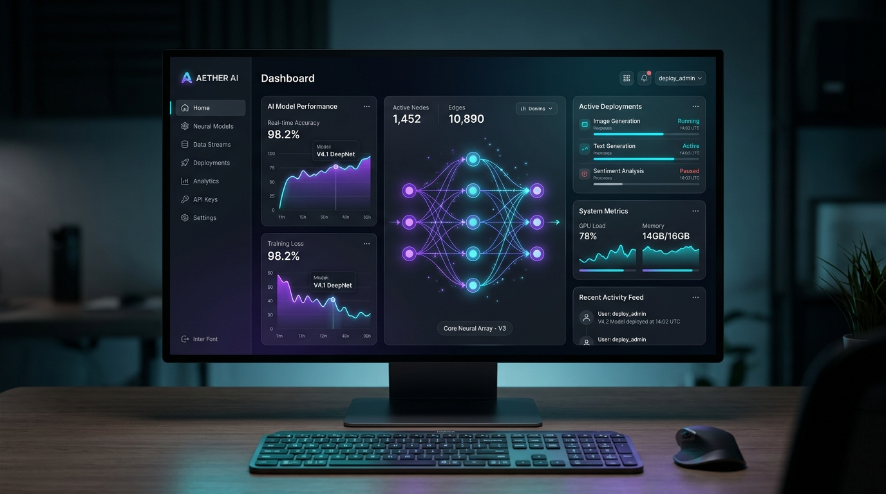

# ⚡ Ronak Prajapat — Full-Stack Developer Portfolio

An interactive, high-performance, and futuristic personal portfolio website showcasing software engineering projects, technical skills, interactive CLI shell, and academic milestones.



## 🌟 Highlights & Features

- **Futuristic Glassmorphic Aesthetic**: Deep midnight space palette (`#08090d`), cyber-cyan glows, frosted glass cards with subtle backdrop blurs.
- **Dynamic Particle Constellation Canvas**: Vanilla HTML5 Canvas connected network that interacts with cursor movements.
- **Interactive Developer CLI Terminal**: Built-in bash-like terminal supporting commands: `help`, `about`, `skills`, `projects`, `education`, `contact`, `theme`, `time`, and secret easter eggs (`matrix`, `sudo`).
- **Web Audio API Synthesizer**: Zero-dependency futuristic audio clicks and sound effects on interactions (toggleable via the top navigation bar).
- **3D Parallax Tilt Card**: Interactive hero profile card featuring custom avatar with floating tech stack chips reacting to mouse positioning.
- **Project Architecture & Case Study Modals**: In-depth breakdown of system architectures, engineering trade-offs, tech stacks, and performance benchmarks for flagship projects.
- **Dual Theme Support**: Dark mode & sleek Light mode with smooth CSS variable transitions and `localStorage` persistence.
- **Interactive Bio & Code Copy**: Formatted JSON developer bio with single-click copy feedback.
- **Live Local Time**: Dynamically calculated Jaipur (IST) clock updated in real-time.
- **Printable ATS Resume Viewer**: Built-in modal resume preview with one-click print/save as PDF.
- **Responsive Layout**: Designed for seamless viewing across smartphones, tablets, laptops, and ultra-wide 4K monitors.

---

## 🛠️ Tech Stack

- **Core**: HTML5, Vanilla CSS3 (Custom Design System & Tokens), Modern JavaScript (ES6+)
- **Graphics & Audio**: HTML5 Canvas API, Web Audio API
- **Typography & Icons**: Plus Jakarta Sans, Inter, Fira Code, Font Awesome 6
- **Tooling**: Node.js static server for local development

---

## 🚀 Quick Start

### 1. Clone the repository
```bash
git clone https://github.com/ronak26bcon0690-tech/Portfolio.git
cd Portfolio
```

### 2. Run locally
You can open `index.html` directly in any web browser, or launch the lightweight local server:

```bash
node server.js
```
Then visit [http://127.0.0.1:3000](http://127.0.0.1:3000) in your browser.

---

## 📂 Project Structure

```
├── assets/
│   └── images/
│       ├── avatar.jpg            # Ronak's custom portrait
│       ├── logo.jpg              # Monogram brand icon
│       ├── project-nexus.jpg     # NexusAI Project preview
│       ├── project-devpulse.jpg  # DevPulse Project preview
│       ├── project-cybervault.jpg# CyberVault Project preview
│       └── project-algovis.jpg   # AlgoVisualizer Project preview
├── favicon.ico                   # Browser tab icon
├── index.html                    # Semantic HTML5 single-page structure
├── style.css                     # Design tokens, themes & animations
├── script.js                     # Interactive canvas, terminal & modals
├── server.js                     # Local development static server
├── .gitignore                    # Excludes binaries & cache files
└── README.md                     # Documentation
```

---

## 📬 Contact & Connect

- **Name**: Ronak Prajapat
- **Institution**: JECRC University, Jaipur
- **Email**: [ronak.26bcon0690@jecrcu.edu.in](mailto:ronak.26bcon0690@jecrcu.edu.in)
- **GitHub**: [github.com/ronak26bcon0690-tech](https://github.com/ronak26bcon0690-tech)
